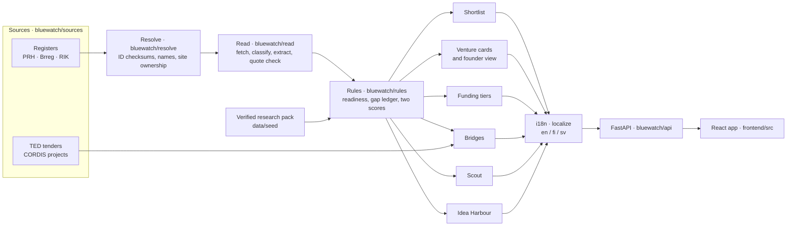

# Architecture

BlueWatch is one Python package (`bluewatch/`) and one React app (`frontend/`), served by a single FastAPI process. Every module talks to the others through the contracts in `bluewatch/models.py`.

## Data flow

Two paths run through the same rules. The **precomputed path** (`bluewatch/demo.py`) turns the research pack and the recorded register, TED and CORDIS responses into lists, cards and catalogues once a day, in a background thread at start-up. The **live path** starts from a business ID a visitor types or picks from a name search, asks that country's register, optionally reads the company's website, and builds a card on the spot.

## Stages

**Contracts** (`bluewatch/models.py`). Pydantic models, versioned by `CONTRACTS_VERSION`: C1 Signal, C2 Company (with its Registry and Resolution), C3 Evidence and the GapLedger, C4 Assessment, Opportunity and ListEntry, C5 OutreachDraft, C6 PrecisionReport, C7 Bridge, C8 HackathonProject and ContactPlan, C9 FounderProfile and FounderView, plus the VentureCard the UI shows. `scripts/gen_ts_types.py` generates `frontend/src/contracts.ts` from them, so the front end and the API cannot drift apart silently. Idea Harbour keeps its own contracts in `bluewatch/ideas/models.py`.

**Sources** (`bluewatch/sources/`). One module per register (`prh.py`, `brreg.py`, `rik.py`), each with `lookup_result`, `search_result` and `fetch_new_companies`, all returning a `ConnectorResult`: records, signals and a `SourceStatus`. `ted.py` and `cordis.py` fetch tenders, awards and research projects. `common.go_live` decides live or recorded from the settings; recorded responses live in `data/fixtures/sources/`, `record.py` re-records them, and the bridge generators read them through `bluewatch/seed.py`. `search.py` asks the three registers in parallel with a short timeout. Sole traders are marked `natural_person` and never leave this layer as companies.

**Resolve** (`bluewatch/resolve/`). `ids.py` validates and normalises registry IDs and VAT numbers by checksum; `names.py` normalises company names and domains. `resolver.py` applies a strict resolution order with five honest outcomes (resolved, probable, ambiguous, unconfirmed, unresolved), and the ten entity traps in `bluewatch/evals/traps.py` run against it. The live path never guesses: it always starts from a register ID.

**Read** (`bluewatch/read/`). `fetch.py` turns a page into readable parts; `site_finder.py` finds the company's own site and refuses sites that only share its name; `classify.py` and `extract.py` ask the model for a classification and claims through the one interface in `bluewatch/llm.py`; `quotecheck.py` keeps a claim only if its quote is on the page. `live.py` runs a read within a 15-second budget, behind the daily spend cap in `bluewatch/spend.py`, and reports why when it cannot finish. `keywords.py` is the offline reader and `evals.py` is the gate a new model must pass.

**Rules** (`bluewatch/rules/`). `assess.py` turns a company and its evidence into an Assessment: readiness levels (`readiness.py`, `scales.py`), ten dimensions (`dimensions.py`), the gap ledger (`gaps.py`) and the potential and evidence scores (`score.py`). `rank.py` builds the shortlist, never padded. `funding.py` and `eligibility.py` sort instruments into certain, likely, possible, excluded or unknown, each with its deciding rule; `investors.py` and `nextsteps.py` order what to do next. A preset (`presets.py`, `data/presets/*.json`) holds a thesis as numbers; the engine is the same for every preset. `version.py` stamps every result with a hash of the rules and presets that produced it. `seed_adapter.py` brings the research pack in with honest tags.

**Outputs.** The shortlist, cards and catalogues are assembled in `bluewatch/demo.py`. `bluewatch/founder/view.py` runs the same rules from the company's side. `bluewatch/bridges/` generates bridges from tenders, research projects, funding calls and regulation, then ranks them by deadline, fit and evidence. `bluewatch/scout/` scores public hackathon projects and plans organisation-level contact routes. `bluewatch/ideas/` vets ideas with a rubric of eight readable criteria. `bluewatch/outreach/` holds the approval state machine and the sending policy. `bluewatch/evals/` measures precision against reference answers, beside an age-only baseline.

**Translate** (`bluewatch/i18n.py`). The rules write English. Each route passes its response through `localize(obj, lang)`, which swaps in Finnish or Swedish from `data/i18n/{fi,sv}.json` for named prose fields only. `scripts/collect_strings.py` lists every string that needs a translation.

**Serve** (`bluewatch/api/`). `app.py` holds the routes and the security headers, `ideas.py` the Idea Harbour routes, `deps.py` the shared request parameters and rate check, `guards.py` the rate limiter and `sessions.py` the per-visitor outreach desks, all in memory. The same process serves the built front end.

**Show** (`frontend/src/`). `api.ts` calls the API with the interface language; `data.ts` falls back to snapshots of the same API output in `fixtures/` (written by `scripts/snapshot_fixtures.py`) and flags them as demo data. Each page is a folder in `screens/`; shared components are in `ui/`, the app frame in `shell/`, and languages in `i18n/`.

## Design decisions

- **Rules, not the model, set levels and scores.** The model only classifies a site and lists claims with quotes. Every level, score, tier and rank comes from code a reviewer can read, stamped with the rules version.
- **Quote-checked extraction.** A claim counts only if its quote is literally on the page, after typography is normalised. There is no fuzzy matching, and page text reaches the model as data, never as instructions.
- **Unknowns lower evidence, never potential.** An unknown readiness level is `None` with a reason, drawn hatched, never zero. An unknown part of potential is left out of the average. A source that failed is "unavailable", not "nothing new".
- **Precomputed and live.** The daily precompute keeps the demo fast and reproducible; the live path proves the same rules work on any company. When anything live fails, the answer says so and the precomputed or register facts remain.
- **Translation at the boundary.** The rules and tests stay in one language, and a missing translation shows English instead of breaking a page.
- **Public-demo guards.** POST bodies for anything a visitor types, no access log, rate limits, a daily spend cap, public internet addresses only for the website reader, `noindex` and a strict content security policy, and an outreach desk that cannot send.

## Extending it

**Add a preset.** Copy `data/presets/blue.json` to `data/presets/<name>.json` and edit it; it is validated strictly on load. The API lists it, accepts `?preset=<name>` and precomputes it with no code change. To offer it in the app, add the name to `PresetName` and `NAMES` in `frontend/src/lib/preset.ts` and its `short_`, `abbr_`, `label_` and `description_` texts to `frontend/src/lib/messages.ts`. Idea Harbour lists presets separately (`PresetName` in `bluewatch/ideas/models.py` and `frontend/src/screens/ideas/types.ts`, `PresetParam` in `bluewatch/api/deps.py` validates presets against `data/presets/`). Add it to `PRESETS` in `scripts/snapshot_fixtures.py` and `scripts/collect_strings.py`, run both, and translate the new strings until `pytest` passes.

**Add a register** (Sweden as the example). Write `bluewatch/sources/scb.py` with the three functions `prh.py` has, mark sole traders as `natural_person`, and record its fixtures so the tests stay offline. `scb` is already a source name in `models.py`, and `resolve/ids.py` already validates Swedish IDs. Then add the country where the three registers are listed: `bluewatch/lookup.py`, `bluewatch/sources/search.py`, `bluewatch/sources/feed.py`, `bluewatch/demo.py` (and its source status), `bluewatch/resolve/names.py` (`GUESS_TLDS`) and the register names in `bluewatch/outreach/templates.py`; in the front end, `Country` in `frontend/src/api.ts` and the country lists in `ui/IdInput.tsx`, `screens/companies/` and `shell/CommandPalette.tsx`. Add tests in `tests/sources/` on the pattern of `test_prh.py`.

**Add a language** (Norwegian as the example). In the API, add the code to `Lang` in `bluewatch/i18n.py`, create `data/i18n/nb.json` covering every string in `data/i18n/source.json`, and add the code to the coverage test in `tests/test_i18n.py`. In the app, add it to `LANGS` in `frontend/src/i18n/lang.ts` and to `LOCALES` and the `Messages` types in `frontend/src/i18n/messages.ts`; the type check then names every `messages.ts` that still needs the new language. Add a guide file in `frontend/src/screens/guide/content/`. Outreach drafts in the new language also need texts in `bluewatch/outreach/templates.py`.
