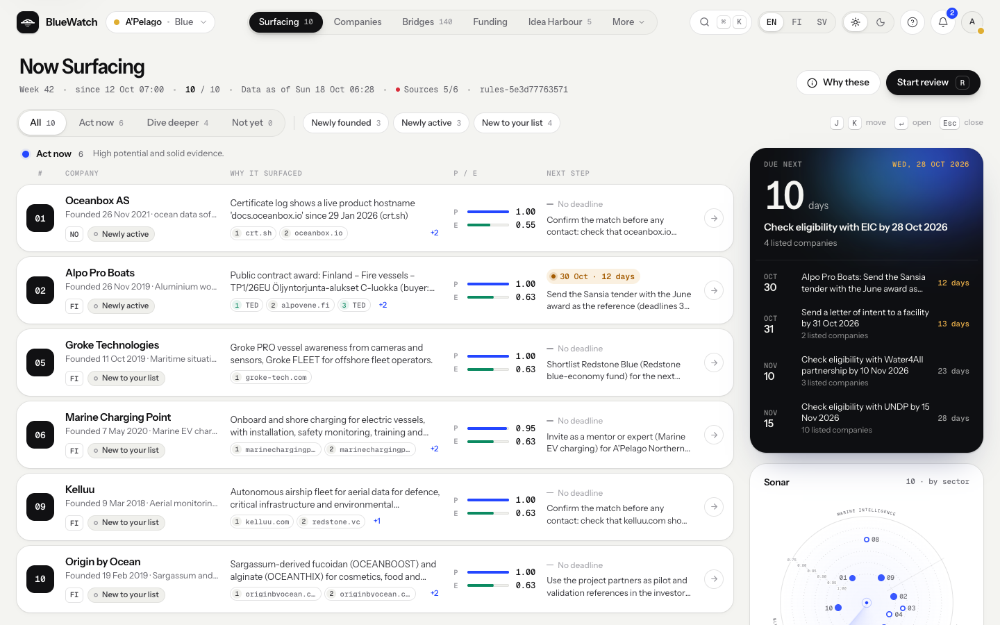
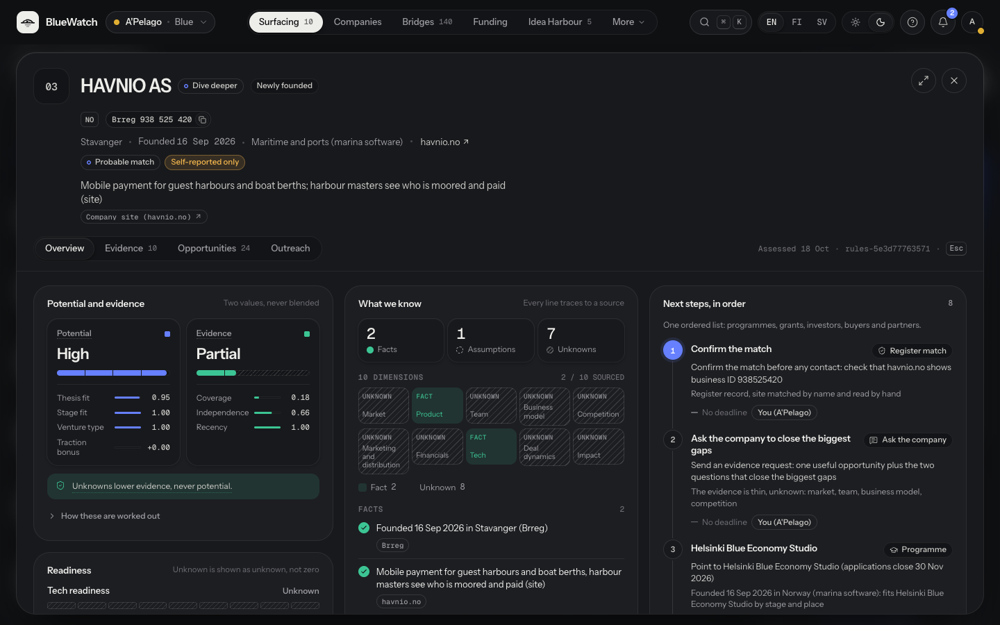
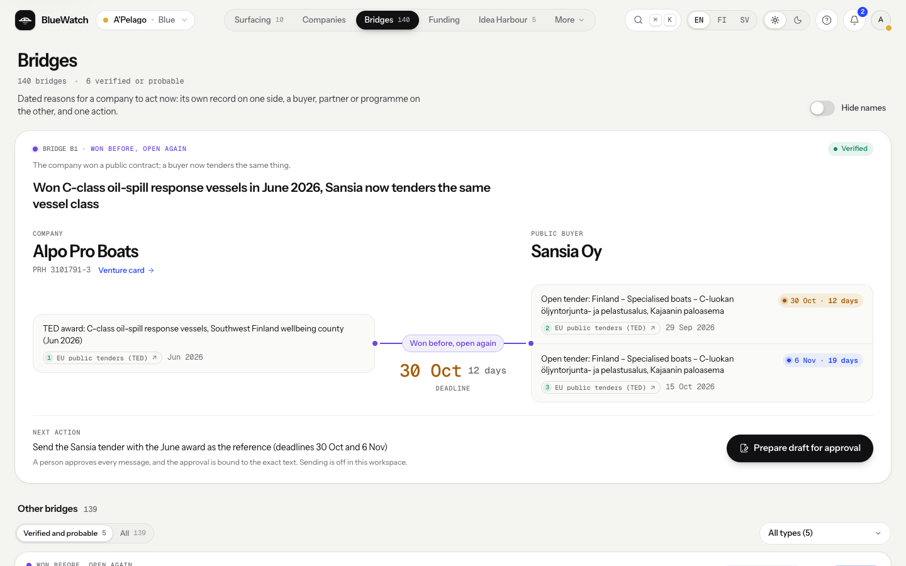
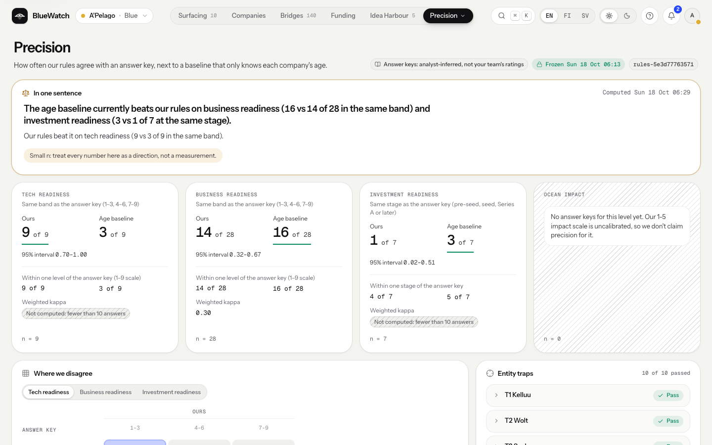
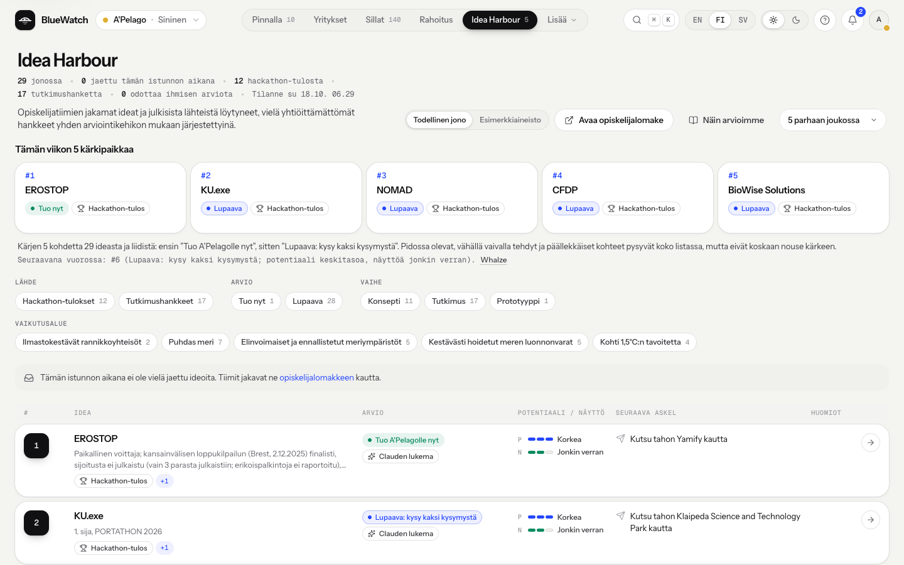
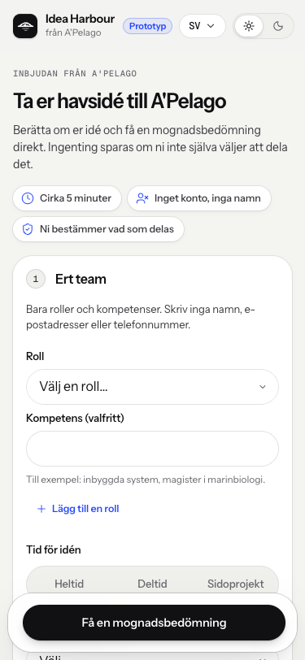

# BlueWatch

BlueWatch finds new ocean companies in public company registers and shows what is known and what is still missing about each one.
For every company it lists the next buyer, partner, grant or investor in priority order, with a source for every claim.



**Live demo:** https://bluewatch.demo.wicflow.com (a public prototype with no login). Built for A'Pelago and Redstone's "Ocean Opportunity Radar" challenge at JunctionX Turku 2026.

| Venture card (graphite theme) | Bridges | Precision |
|---|---|---|
|  |  |  |

| Idea Harbour review queue (Finnish) | Idea Harbour student page (Swedish, phone) |
|---|---|
|  |  |

## Run it

You need Python 3.12 and Node 24. On macOS or Linux, from the repo root:

```bash
python3.12 -m venv .venv && .venv/bin/pip install -e ".[dev]"
(cd frontend && npm ci && npm run build)
.venv/bin/uvicorn bluewatch.api.app:app --port 8787    # then open http://127.0.0.1:8787
```

It runs offline out of the box, from the recorded data in `data/`. Settings are environment variables only; `.env.example` names every one with its default, and a `.env.local` at the repo root is loaded automatically. Set `BLUEWATCH_LIVE_LOOKUPS=1` to call the live registers, and `ANTHROPIC_API_KEY` as well to read company websites. For front-end work, `cd frontend && npm run dev` serves the UI on port 5173 and passes `/api` to port 8787.

## Architecture

- **Sources** (`bluewatch/sources/`) read the Finnish, Norwegian and Estonian company registers, EU public tenders (TED) and EU research projects (CORDIS). A source that cannot answer is shown as unavailable, never as an empty result.
- **Resolve and read** (`bluewatch/resolve/`, `bluewatch/read/`). A company is identified by a registry ID with a valid checksum, never by a loose name. The reader classifies the company's own website and extracts claims through one model interface (Claude); a claim is kept only if its quote is literally on the page.
- **Rules, not the model** (`bluewatch/rules/`), set the four readiness levels, the ten dimensions, the gap ledger and the two scores, then rank the shortlist and order the next steps across programmes, grants, investors and buyers. Unknowns lower the evidence score, never the potential score.
- **Bridges, scout and Idea Harbour** link a company to a counterparty with evidence on both sides and a dated action, rank public hackathon projects, and vet pre-company ideas against a rubric anyone can read.
- **One FastAPI process** (`bluewatch/api/`) serves the API and the built React app. Lists and cards are precomputed once a day; lookups, name search and the website read run live. The API translates its own prose into Finnish or Swedish on the way out.

The data flow, the design decisions and how to add a preset, a register or a language are in [ARCHITECTURE.md](ARCHITECTURE.md).

## Folder map

| Path | What it holds |
|---|---|
| `bluewatch/models.py` | The contracts every module shares (C1 to C9) |
| `bluewatch/sources/` | Register, tender and research-project connectors, live or recorded |
| `bluewatch/resolve/` | Registry IDs, VAT numbers and company names: checksums and matching |
| `bluewatch/read/` | Website fetching, the model reader, the quote check and the reader's eval |
| `bluewatch/rules/` | Readiness, gaps, scores, ranking, funding tiers, investors, next steps, presets |
| `bluewatch/founder/` | The founder view: the same rules, seen from the company's side |
| `bluewatch/bridges/`, `bluewatch/scout/` | Opportunity bridges; the hackathon scout |
| `bluewatch/ideas/` | Idea Harbour: the idea form's rubric, vetting and review queue |
| `bluewatch/outreach/` | The outreach desk: drafts, approval, policy and audit (demo mode) |
| `bluewatch/evals/` | Precision against reference answers, the baseline, the entity traps, blind sets |
| `bluewatch/api/` | HTTP routes and the public guards (rate limits, sessions) |
| `bluewatch/demo.py` | Builds the precomputed results: shortlist, cards and catalogues |
| `bluewatch/lookup.py` | The live business-ID lookup |
| `bluewatch/i18n.py`, `bluewatch/spend.py` | Translation at the boundary; the daily spend cap on model calls |
| `bluewatch/config.py`, `bluewatch/labels.py`, `bluewatch/llm.py`, `bluewatch/net.py` | Settings, display names, the model interface, shared HTTP access |
| `frontend/src/` | The React app: `screens/` (one folder per page), `ui/`, `shell/`, `i18n/` |
| `data/` | The verified research pack, presets, recorded responses, eval sets and translations (see `data/README.md`) |
| `scripts/` | Generate the TypeScript contracts, the UI's fallback snapshots and the list of strings to translate |
| `tests/` | One folder per package, offline |
| `Dockerfile`, `deploy/` | One container and its compose files (see [DEPLOY.md](DEPLOY.md)) |

## Where the key logic lives

- **Readiness levels:** `bluewatch/rules/readiness.py`, from the cues in `bluewatch/rules/scales.py`.
- **Gap ledger:** `bluewatch/rules/gaps.py`.
- **Potential and evidence scores:** `bluewatch/rules/score.py`.
- **The shortlist:** `bluewatch/rules/rank.py`.
- **Funding tiers:** `bluewatch/rules/funding.py` and `bluewatch/rules/eligibility.py`.
- **Investor order:** `bluewatch/rules/investors.py`.
- **Next steps:** `bluewatch/rules/nextsteps.py`.
- **Quote check:** `bluewatch/read/quotecheck.py`; the live website read is `bluewatch/read/live.py`.
- **Entity resolution:** `bluewatch/resolve/resolver.py` and `bluewatch/resolve/ids.py`.
- **Bridges:** `bluewatch/bridges/generators/` and `bluewatch/bridges/rank.py`.
- **Idea rubric:** `bluewatch/ideas/rubric.py`.
- **Outreach policy:** `bluewatch/outreach/policy.py` and `bluewatch/outreach/desk.py`.

## Design rules

- `bluewatch/models.py` is the only interface between modules. To change a contract, bump `CONTRACTS_VERSION`, update `tests/test_contracts.py` and regenerate `frontend/src/contracts.ts` with `scripts/gen_ts_types.py`.
- Tests never touch the network: connectors and the reader run on recorded responses.
- Unknown is not zero. A missing fact is shown as unknown with a reason, and a failed source as unavailable.
- Organisations, never people: no personal names, e-mail addresses or phone numbers in the data, the code or the logs.

## Tests

```bash
.venv/bin/ruff check .
.venv/bin/ruff format --check .
.venv/bin/pytest                     # offline: the tests cannot reach the network
(cd frontend && npm run check)       # prettier, eslint and the TypeScript check
```

The front end has no unit tests of its own: the type check covers the shared contracts and the translation catalogues, and the backend tests cover the API it renders. CI runs the same commands plus the front-end build on every push (`.github/workflows/ci.yml`).

## Maintenance commands

Run by hand from the repo root; none of them runs in the tests.

```bash
.venv/bin/python -m bluewatch.sources.record live            # re-record the register, search and TED fixtures
.venv/bin/python -m bluewatch.read.evals --model <model>     # the gate a new reader model must pass
.venv/bin/python -m bluewatch.rules.calibration              # the rules against the answer keys
.venv/bin/python scripts/gen_ts_types.py                     # frontend/src/contracts.ts from models.py
.venv/bin/python scripts/snapshot_fixtures.py                # the UI's fallback snapshots
.venv/bin/python scripts/collect_strings.py                  # strings to translate into data/i18n/source.json
```

## What is live, recorded and planned

**Live on the public demo**
- Business-ID lookup in the Finnish (PRH), Norwegian (Brreg) and Estonian (RIK) registers, turned into a venture card and a founder view by the same rules.
- Company name search across the three registers and the precomputed set.
- The website reader: Claude classifies the company's own site and lists claims, each quote-checked against the page. It runs under a daily spend cap; when the cap, the time limit or an error stops it, the card keeps its register facts and says why.
- Idea Harbour: the rules vet a team's idea against the rubric. Claude adds quoted claims only when the team ticks the box and the server allows it, and it never rates or ranks.
- The outreach desk: a draft, approval bound to the exact text, and an audit trail. **It never sends e-mail.** "Send" ends in a demo state, and the company's reply is simulated and labelled as such.

**Recorded, dated 16 to 17 Oct 2026**
- The shortlist, venture cards, bridges, funding catalogue and scout are computed by the rules from a verified research pack and recorded register, TED and CORDIS responses. The app shows each source's state: live, daily file, recorded or unavailable.
- Precision is computed by `bluewatch/evals/` and served by `/api/precision`. The numbers on screen come from the API, not from this file.
- If the API cannot be reached, the app falls back to snapshots of the same API output (`frontend/src/fixtures/`) and shows a "Demo data" chip.

**Planned**
- A scheduled scan for new companies. The connectors' new-company feeds (`bluewatch/sources/feed.py`) are built and tested on recorded data but do not run on a schedule yet.
- Sweden. The SCB bulk file also lists sole traders by personal number, so it needs an import that keeps legal persons only. Until then the app shows SCB as unavailable rather than counting it as zero.
- Real sharing with A'Pelago. In the public demo a shared founder profile or idea never leaves the server's memory of that browser session.
- More EU registers. Implementing Regulation (EU) 2023/138 requires business registers to publish company data openly; each new country is a connector plus the wiring listed in ARCHITECTURE.md.

## Languages

English is the default; Finnish and Swedish are one click away and remembered per browser. Interface text lives next to each feature in its `messages.ts`, and the type check fails if a Finnish or Swedish string is missing. The API's own prose (reasons, rules, next steps) is translated at the boundary by `bluewatch/i18n.py` from the tables in `data/i18n/`. Names, quotes, URLs, IDs and dates stay as the source wrote them, and a test fails when a string has no translation or a translation changes a number.

The API tables are keyed on whole English sentences, collected by running the pipeline over the coming days (`scripts/collect_strings.py`). A sentence the collector has not seen, such as one about a company from a live lookup, falls back to English.

## Data sources and licences

The code is © 2026 Wicflow Oy, all rights reserved (see [LICENSE](LICENSE)). The data below keeps its own licence.

- **Finnish Patent and Registration Office (PRH):** CC BY 4.0.
- **Brønnøysund Register Centre (Brreg):** NLOD 2.0.
- **Estonian e-Business Register (RIK):** CC BY 4.0.
- **TED and CORDIS:** © European Union, CC BY 4.0.
- **Company and investor websites:** facts are quoted briefly, with a link to the page.

What each file holds and where it came from is in `data/README.md`.

## Privacy

- **What a visitor types is never stored or logged.** IDs, names and idea text travel in POST bodies, go only to the register being searched (and to Claude only when a team opts in), and the container runs without an access log on a read-only file system.
- **Organisations, never people.** The data holds no names, e-mail addresses or phone numbers of people. A sole trader is a private person, so the app shows no details, no card and no ranking for one.
- **Nothing is sent to a company.** Every draft needs a person's approval bound to its exact text, and the public app has no path that sends e-mail.
- **Bounded by design.** No login, no analytics or trackers, no third-party requests from the browser (fonts are self-hosted), `noindex` on every response, a strict content security policy, per-IP and global rate limits, and a daily spend cap on model calls. The website reader fetches public internet addresses only.
